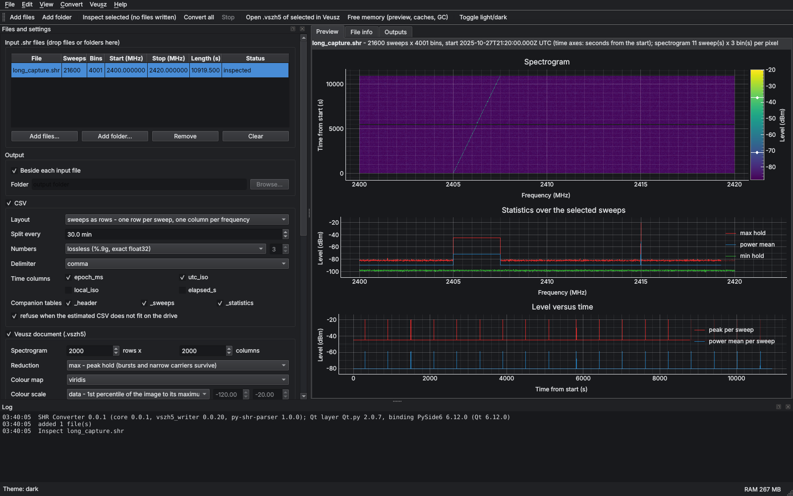
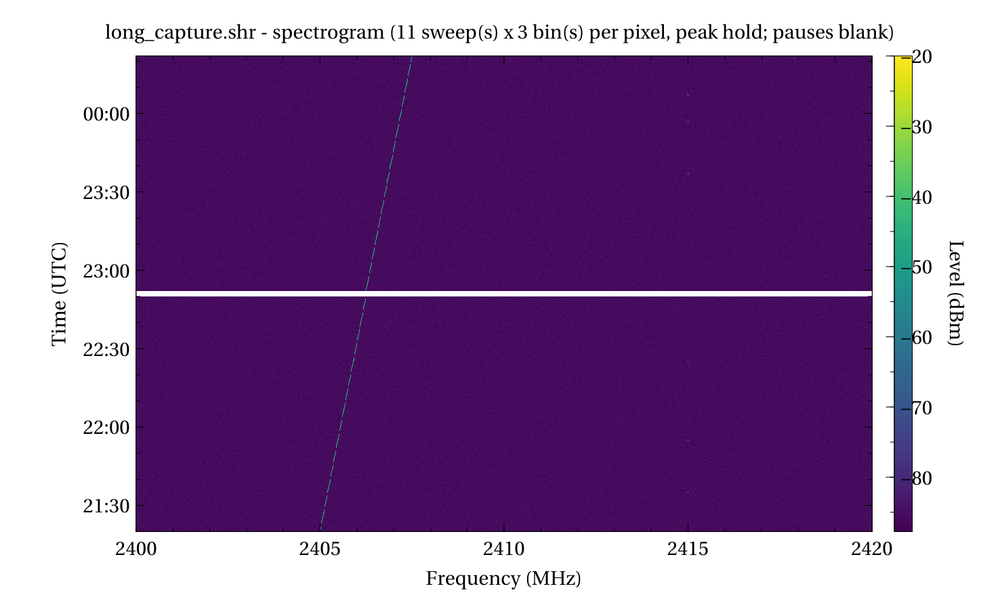

# SHR Converter 0.0.1

A Qt GUI and command-line tool that converts Signal Hound Spike `.shr` sweep recordings into **CSV** files and native **Veusz** documents (`.vszh5`), with optional PDF (bookmarked) and PNG renders. Files are read with **py-shr-parser 1.0.0** [1] and written with your **vszh5_writer 0.0.20**, which this release brings up to date (see `docs/WRITER_0.0.20_NOTES.md`).



## Files

| File | Version | Purpose |
|---|---|---|
| `shr_converter.py` | 0.0.1 | Launcher: GUI by default, `--cli`, `--selftest`, `--gui-smoke` (keeps Qt out of the worker processes) |
| `shr_converter_gui.py` | 0.0.1 | Qt.py / PySide6 GUI: menus, toolbar, light/dark/system theme, preview, background tasks |
| `shr_converter_core.py` | 0.0.1 | Engine: reading, CSV, statistics, spectrogram, `.vszh5`, workers, GPU, command line, self-test |
| `vszh5_writer.py` | **0.0.20** | Your Veusz HDF5 writer, merged and extended (drop-in for every program) |
| `tests/test_shr_converter.py`, `tests/test_vszh5_writer.py` | 0.0.1 | pytest suites |
| `tests/long_capture_check.py`, `tests/memory_check.py` | 0.0.1 | 3-hour capture check; memory-bound check |
| `docs/SHR_Converter_Manual_v0.0.1.pdf` (+ `.tex`) | 0.0.1 | LuaLaTeX manual with bookmarks (F1 in the GUI) |
| `docs/WRITER_0.0.20_NOTES.md` | | Writer merge, drop-in results, the two test literals to update |
| `docs/validation/` | | Every test log of this release |

Every Python file carries your header block and Spyder `# %%` cells.

## Install and run (mamba)

```
mamba env create -f environment.yml          # Python 3.12 + pip packages from requirements.txt
mamba activate shr-converter
mamba install -c conda-forge veusz           # optional: viewer and PDF/PNG render (or the Veusz installer)
mamba install -c conda-forge cupy            # optional: NVIDIA GPU for the statistics
python shr_converter.py                      # GUI (Windows: run_shr_converter.bat)
python shr_converter.py --selftest --gui-smoke
```

On Windows, `create_environment.bat` creates the environment once, `run_shr_converter.bat` starts the GUI (you can drop files on it), and `run_selftest.bat` runs every check.

## Using the GUI

1. **Add files** (Ctrl+O), a folder (Ctrl+Shift+O), or drag files or folders onto the window. Each file's header is read at once: sweeps, bins, frequency span, length, and notes for recordings that were cut short.
2. **Inspect** (Ctrl+I) runs the full statistics pass **without writing anything** and shows the preview: spectrogram, statistics spectrum, and level versus time. The *File info* tab shows the plan, the CSV size estimate, the seconds of recording per spectrogram row, and the free space on the output drive.
3. **Convert** (F5 converts every file, Shift+F5 the selected ones). **Stop** (Esc) stops after the current block and deletes that file's partial outputs.
4. **Veusz > Open** (Ctrl+Shift+Z) opens the document in Veusz; **Render** (Ctrl+R) writes the PDF and PNGs.

Menus: File, Edit, View (**Theme: System / Light / Dark**, Ctrl+T toggles), Convert, Veusz, Help (F1 manual, shortcuts, About). The settings, recent files and window layout are kept between sessions.

## Outputs

| File | Content |
|---|---|
| `<name>.csv` (or `<name>_part001.csv`, …) | Amplitudes, in one of three layouts (below) |
| `<name>_header.csv` | Every file-header field with its unit, the derived values, the CSV parts with their time spans, versions |
| `<name>_sweeps.csv` | One row per sweep: time, GPS, ADC overflow, peak, peak frequency, power mean over the band |
| `<name>_statistics.csv` | One row per bin: max hold, min hold, power mean, dB mean, standard deviation, count |
| `<name>.vszh5` | Pages: spectrogram, statistics, selected sweeps, level versus time, GPS track (if any), file header |
| `<name>.pdf`, `<name>_pNN_<page>.png` | Optional render: PDF with a bookmark tree, PNGs on white |

| CSV layout | Rows × columns | Use |
|---|---|---|
| `sweeps_as_rows` (default) | one row per sweep: index, times, GPS, overflow, then one column per frequency (header = Hz) | MATLAB, pandas, Veusz |
| `frequencies_as_rows` | one row per bin: frequency, then one column per sweep | short captures; the file is read once per column block |
| `long` | one row per sample: index, times, frequency, amplitude | databases, tidy data |

Numbers are **lossless** by default: `%.9g` round-trips every float32 exactly [5]. Every value of every layout was checked against py-shr-parser. **Fixed decimals** give smaller files. Time columns: `epoch_ms`, `utc_iso`, `local_iso`, `elapsed_s`. Excel opens at most 16,384 columns and 1,048,576 rows [6]; the plan warns when a layout exceeds that.

## Long captures (hours)

A 3-hour recording can hold millions of sweeps. The converter handles that with:

* **CSV split by time**: e.g. 30 min gives 7 files for 3 h 02 min, each with the header line. Pauses are respected, and `_header.csv` lists each part's time span.
* **Disk-space check**: the CSV size is estimated (within 1–15 % here) and the conversion refuses to start when the drive cannot hold it.
* **Per-sweep table memory-mapped on disk** when large (57 bytes per sweep).
* **Thinned time series** in Veusz (default 100 000 points). The thinning uses peak hold for the peak, power mean for the band level, the frequency of the strongest sweep, and any-overflow. Tested: every burst survives.
* **Spectrogram on an even time grid**: pauses show as blank bands, and Veusz draws it in 6.7 s with 0.27 GB instead of 34 s with 3.2 GB.
* **Time resolution**: 2000 rows over 3 h is 5.4 s per row; raise *Spectrogram rows* for finer time.



## Performance and memory (measured on 2 CPU cores, no GPU)

| Case | Data | Time | Peak memory (all processes) |
|---|---|---|---|
| Spike's `sweep0v2.shr`, 417 × 16 386 | 26 MiB to 78 MiB CSV + `.vszh5` | 3.3 s (1 worker) | – |
| 3 h at 2 sweeps/s × 4001 bins | 331 MiB to 981 MiB CSV in 7 files | 34.5 s (1 worker); **20.5 s (2 workers)**; 25.8 s with the PDF/PNG render | 0.71 GiB (1 worker); 0.86 GiB (2 workers + render) |
| 3 h at 50 sweeps/s × 512 bins (540 000 sweeps) | 1.1 GiB to 1.8 GiB CSV (2 decimals) | 52.8 s (2 workers) | 0.51 GiB |
| 3000 × 65 536 bins, RAM budget 256 MB | 750 MiB to 2.2 GiB CSV | 41.4 s (2 workers) | 0.41 GiB (0.45 GiB for a file half the size: set by the budget, not the file) |

The recorded runs are in `docs/validation/long_capture_and_memory_0.0.1.txt`.

**Parallelism.** Blocks of sweeps are read, formatted and reduced in worker processes started with *spawn* (a GUI is never forked); results merge exactly, in order, with at most 2 × workers blocks in flight. Default workers = CPUs − 1, at most 61 on Windows. The per-sweep table of long captures is formatted in parallel too. Going from 1 to 2 workers took throughput from 2.5 to 4.3 M samples/s here; your i9 has many more cores.

**GPU.** With CuPy and a CUDA device, the statistics and spectrogram reduction run on the GPU in 2 M-sample sub-blocks. *auto* uses it for blocks of at least 1 M samples. Any GPU error repeats that block on the CPU; the results are identical. CSV text formatting has no GPU path. The GPU code path was exercised with a NumPy stand-in, because there is no GPU here (see *Data gaps*).

**Memory.** Use *Edit > Free memory* (Ctrl+Shift+M). Previews are pickled to disk, and only the file shown is kept in memory. Memory is also flushed after each file (garbage collector, CuPy pools, malloc_trim / EmptyWorkingSet).

## Command line

```
python shr_converter.py --cli capture.shr -o out --split-minutes 30 --render
python shr_converter.py --cli folder_of_shr/ --layout long --fixed 2 --sweeps 0:0:10 --freq 2400:2420
python shr_converter.py --cli --info capture.shr          # header and plan only
python shr_converter.py --cli --help                       # every option
```

## Statistics (what the numbers mean)

| Quantity | Definition (x = level of a bin in one sweep) |
|---|---|
| Max / min hold | max / min of x over the selected sweeps |
| Power mean (dBm) | $10\log_{10}\big(\tfrac1N\sum_k 10^{x_k/10}\big)$, in linear power |
| dB mean (dBm) | $\tfrac1N\sum_k x_k$; reads about 2.51 dB low for noise [4] |
| RMS (mV files) | $\sqrt{\tfrac1N\sum_k x_k^2}$ |
| Band power mean per sweep | power mean over the selected bins; a mean power per bin, **not** a channel power |
| Frequency of bin i | first_bin_freq_hz + i · bin_size_hz (from the file header) |

The −2.51 dB log-average bias of Rayleigh noise is $-10\gamma/\ln 10 = -2.507$ dB, where γ is Euler's constant; a 10⁷-sample simulation here gave −2.5067 dB.

## Data gaps and confidence

| Item | Status | Confidence |
|---|---|---|
| Reading real Spike files | Spike's own `sweep0v2.shr` (format v2, dBm, 417 × 16 386) read exactly, CSV round trip bit-exact | High |
| mV-scale recordings | Synthetic only (RMS statistics checked) | Medium; send one |
| Title field encoding | Decoded as UTF-16LE when it looks like it, else UTF-8. The test file's title is empty, and Signal Hound's format document is inside their SDK | Medium; send a titled file |
| Channelized recordings | Not handled specially (py-shr-parser reads the sweeps as stored) | Unknown |
| Bin frequencies | Header `first_bin + i·bin_size`. py-shr-parser's plotting helpers use `linspace(f_min, f_max, n)` instead, which is off by up to 1 bin at the top for `sweep0v2.shr` | High |
| GPU path | Exercised with a NumPy stand-in, including out-of-memory fallback; not run on a real CUDA device here | Medium |
| Windows | Written for it: spawn workers, the 61-worker limit, Excel-locked CSV kept under a time-stamped name, EmptyWorkingSet. Tested on Linux | Medium; run `run_selftest.bat` on txrx03 |
| CSV size estimate | Within 1 % (lossless) to 15 % (2 decimals) on the tests | High |

## References

| # | Reference (IEEE) | URL |
|---|---|---|
| [1] | T. Schmitz, "py-shr-parser: Python library for parsing Signal Hound SHR files," v1.0.0, WiSE Lab, Carnegie Mellon Univ., 2025. | https://github.com/WiseLabCMU/py-shr-parser |
| [2] | Signal Hound, ".shr file format specification," BB Series Discussions forum, May–Aug. 2018. | https://signalhound.com/?p=158701 |
| [3] | Signal Hound, "Open recording .shr file in MATLAB," BB Series Discussions forum, Jul. 2019. | https://signalhound.com/support/forums/topic/open-recording-shr-file-in-matlab/ |
| [4] | Hewlett-Packard, "Measuring Noise and Noise-like Digital Communications Signals with a Spectrum Analyzer," Application Note 1303, lit. no. 5966-4008E. | https://www.hpmemoryproject.org/an/pdf/an_1303.pdf |
| [5] | IEEE, "IEEE Standard for Floating-Point Arithmetic," IEEE Std 754-2019, pp. 1–84, Jul. 2019, doi: 10.1109/IEEESTD.2019.8766229. | https://doi.org/10.1109/IEEESTD.2019.8766229 |
| [6] | Microsoft, "Excel specifications and limits." | https://support.microsoft.com/en-us/office/1672b34d-7043-467e-8e27-269d656771c3 |
| [7] | Keysight Technologies, "Spectrum Analysis Basics," Application Note 150, 5952-0292. | https://www.keysight.com/us/en/assets/7018-06714/application-notes/5952-0292.pdf |
| [8] | Python Software Foundation, "concurrent.futures — Launching parallel tasks," Python 3.12 docs. | https://docs.python.org/3.12/library/concurrent.futures.html |
| [9] | Preferred Networks, "CuPy documentation." | https://docs.cupy.dev/ |
| [10] | J. Sanders, "Veusz — a scientific plotting package." | https://veusz.github.io/ |
| [11] | M. Ottosson *et al.*, "Qt.py," v2.0.7. | https://github.com/mottosso/Qt.py |
| [12] | R. Regan, "Number of digits required for round-trip conversions," Exploring Binary. | https://www.exploringbinary.com/number-of-digits-required-for-round-trip-conversions/ |
