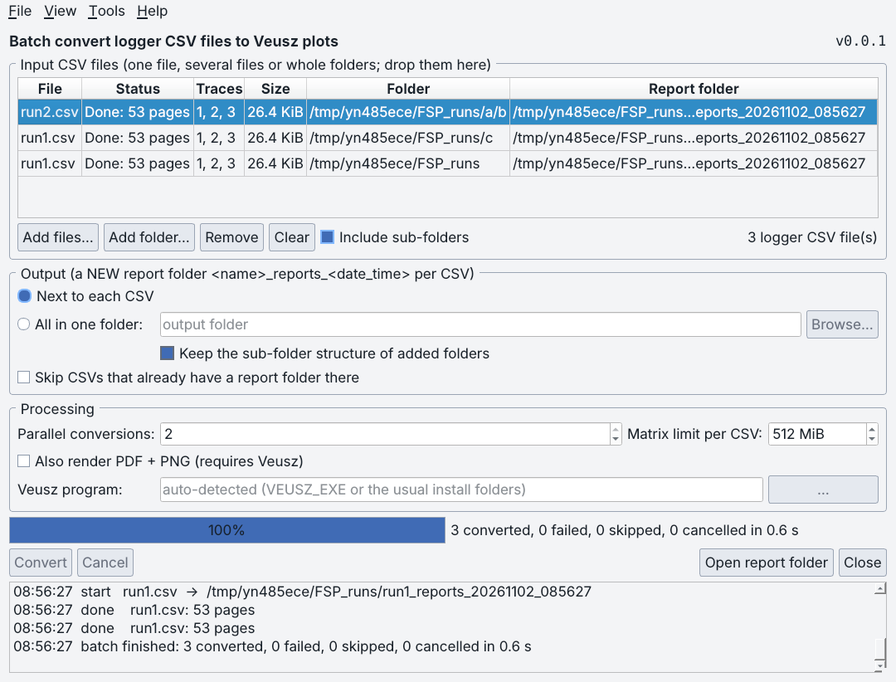

# R&S FSP Logger 0.10.0

Author / application owner: William W. Wallace, NRAO/GBO, wwallace@nrao.edu.
AI-assisted (Claude) update, 2026-10-29 to 2026-11-02, from the `fsp_logger_0.9.0` folder of
`Braveheart53/RF_Equipment_Comms` (commit `b4223e9`). Owner attribution and the
existing writer GPL notices are retained. The logger's own licence is not
declared by the owner; none is inferred or changed.

## What changed in 0.10.0

| Area | Change |
|---|---|
| **New: batch conversion** | *File* (and *Tools*) > **Batch convert CSV files to Veusz plots…** (Ctrl+Shift+R) opens one dialog that converts a single CSV, several CSVs or whole folders, optionally with sub-folders. It produces the same native Veusz reports as the single-file button, several CSVs at a time. See [Batch convert CSV files](#batch-convert-csv-files-to-veusz-plots). |
| **New: stand-alone batch converter** | The same dialog is its own program. Run `python fsp_batch_convert.py` or double-click `run_batch_converter.bat`; no logger window is needed. `--cli` runs it without a window. |
| Theme | The dialog follows the logger's Dark / Light / System choice, and changing it in either window changes both. The palette and style sheet moved, with unchanged values, to `fsp_gui_theme.py`. |
| Interlocks | Sampling cannot start while a batch runs, and a batch cannot start while the logger samples, waits for its start time or drains its CSV. Single reports already follow the same rule. Closing the logger waits for a running batch. |
| Writer `vszh5_writer.py` 0.0.21 | Replaces 0.0.18 with the one writer used across the projects. It keeps the three FSP render fixes and adds the AB-monitor appender and the SHR Converter helpers. The file is byte-identical to the copy in `shr_converter_0.0.2`. |
| Launchers | `run_fsp_logger.bat` and `run_batch_converter.bat` use the mamba environment `fsp-logger` when it exists. |

## Changes in 0.9.0

| Area | Change |
|---|---|
| **New: Reset Active Traces** | Button (Status panel), **F7**, *Acquisition* and *Tools* menus, toolbar. Every displayed trace of the screen in use goes to **Clear/Write** and then back to its own mode, which restarts max hold, min hold and average on the analyzer. Works idle and while recording (between captures, logged to `<csv>_events.csv`). |
| **Fix: Auto / A / B had to be toggled** | Four causes, all fixed. Trace modes were read from Screen A whatever screen was selected. The selected Screen button was not applied to a new connection. Auto detected the screen only once per connection. Trace fetches could fall back to the other screen. Details are in [Screen A / B / Auto](#screen-a--b--auto) and `docs/DEFECT_ANALYSIS_0.9.0.md`. |
| New: screen visibility | An *In use: Screen B (auto)* label, LED tooltips that name each trace's mode, LEDs filled at connect, and Diagnostics that compares both screens side by side. |
| New: Demo Mode | Runs the **real** `FSPInstrument` over `fsp_simulator.py`, a simulated two-screen FSP that returns synthetic data. Demo therefore exercises screen routing and the reset exactly as hardware does. |
| Writer `vszh5_writer.py` 0.0.18 | Newest writer across the projects (0.0.17 was the latest found; the RF project copy is 0.0.14). It adds three render fixes, confirmed on real Veusz 4.2.1, and repairs the revision history. See [Veusz writer](#veusz-writer-0018). |
| Reports `fsp_reports.py` 0.1.4 | The logger version in `report.json` and the document generator line was hard-coded as "0.8.3". It is now read from `rs_fsp_logger.py`. |

## Install and run (Python 3.8–3.12)

Keep all eight Python modules together. Dependencies are not bundled.

With mamba (Miniforge), using the pip pins that were tested:

```console
mamba create -n fsp-logger -c conda-forge python=3.12 pip
mamba activate fsp-logger
python -m pip install -r requirements.txt
python rs_fsp_logger.py --demo
python fsp_batch_convert.py            # batch converter on its own
python -m unittest discover -s tests -v
```

On Windows you can double-click `run_fsp_logger.bat` or `run_batch_converter.bat` instead. You
can also drop CSV files or folders on `run_batch_converter.bat`.

Plain pip works the same way: `python -m pip install -r requirements.txt`.

Remove `--demo` to use hardware. Then choose the CSV, pick **Screen (Auto / A / B)**
*before or after* Connect, connect, check the *In use* label and LEDs, and press Start.
Stop, and let the CSV drain before *Create Veusz Plots / Reports*, which writes into a NEW report
directory. Optional PDF/PNG output needs a working Veusz with h5py (set it from
*Tools* or `VEUSZ_EXE`). Writing the native `.vszh5` needs only h5py, not Veusz.

QtPy runs the GUI on PyQt5 (the pinned default) or PySide6. With PySide6 6.7, set `QT_API=pyside6`.
Both bindings pass the same tests (see Validation).

## Versions

| Component | Version | Role |
|---|---:|---|
| `rs_fsp_logger.py` | **0.10.0** | GUI, instrument layer, acquisition worker; batch menu item |
| `fsp_batch_convert.py` | **0.0.1 (new)** | Batch dialog, stand-alone window and `--cli` |
| `fsp_batch_core.py` | **0.0.1 (new)** | Batch logic without Qt: discovery, planning, report processes, headless runner |
| `fsp_gui_theme.py` | **0.0.1 (new)** | Dark / Light / System theme shared by the logger and the dialog |
| `fsp_background.py` | 0.2.0 | Ordered CSV writer, display mailbox, event log (unchanged) |
| `fsp_reports.py` | 0.1.5 | Report process (native `.vszh5`, statistics, optional PDF/PNG); header only |
| `vszh5_writer.py` | **0.0.21** | Native Veusz HDF5 writer, the same file in every project |
| `fsp_simulator.py` | 0.0.1 | Simulated two-screen FSP SCPI session (unchanged) |
| `tests/test_merge.py` | 0.0.3 | The 0.8.3 suite (17 tests); the grammar check also covers the three new modules |
| `tests/test_screen_and_reset.py` | 0.0.2 | Screen routing, trace reset, worker and GUI regressions (22 tests); expects writer 0.0.21 |
| `tests/test_writer_render.py` | 0.0.1 | Writer render fixes, with an optional real-Veusz test (5 tests, unchanged) |
| `tests/test_batch_convert.py` | **0.0.1 (new)** | Batch core, command line, dialog, stand-alone launcher and logger integration (24 tests) |
| `docs/repro_0.8.3_screen_defects.py` | 0.0.1 | Evidence script for the 0.8.3 defects |

Every Python file carries its version and revision history (newest first) in its header,
and Spyder `# %%` cells are kept.

## Batch convert CSV files to Veusz plots

Open it from the logger with *File* or *Tools* > **Batch convert CSV files to Veusz plots…**
(Ctrl+Shift+R), or on its own:

```console
python fsp_batch_convert.py                         # window
python fsp_batch_convert.py D:\runs a.csv b.csv     # window with these inputs listed
python fsp_batch_convert.py --theme dark            # override the stored theme once
python fsp_batch_convert.py --cli D:\runs --output-dir D:\reports --render --jobs 3
python fsp_batch_convert.py --cli --help            # all command-line options
```



| Part of the dialog | What it does |
|---|---|
| **Inputs** | *Add files…* (one or many), *Add folder…* (with *Include sub-folders*), drag and drop onto the dialog, or paths given on the command line. Only logger CSVs are listed, recognised by the header `date,time,timestamp_iso,freq_hz,trace<n>_dBm`. Other CSVs found in a folder (report tables, `<run>_events.csv`, unrelated files) are skipped and named in the log. *Remove*, *Clear* and the Delete key edit the list. |
| **Output** | Each CSV gets a **new** folder `<csv name>_reports_<date_time>`. *Next to each CSV*, or *All in one folder*; the latter optionally keeps the scanned sub-folder structure, so equal names in different folders never collide. An existing folder is never overwritten (`_2`, `_3` … are added). *Skip CSVs that already have a report folder there* skips a CSV when a `<name>_reports_*` folder holding `report.json` exists. |
| **Processing** | *Parallel conversions* (default: half the logical CPUs, 1 to 4). Each CSV runs `fsp_reports.py` in its own process with one BLAS thread, so memory is released per file and one bad CSV cannot stop the others. *Matrix limit per CSV* is `--max-matrix-mib`. *Also render PDF + PNG* needs Veusz with h5py; the Veusz program setting is shared with the logger. |
| **Run** | *Convert* (F5) processes every row that is not Done; failed or cancelled rows can be re-run. *Cancel* empties the queue, ends running conversions and removes their unfinished hidden staging folders. The table shows each file's status and report folder; *Open report folder* or a double-click opens it. |
| **Menus** | *File* (add, remove, convert, cancel, exit or close), *View > Theme*, *Tools* (Veusz program, open report folder), *Help* (usage, About). |

| Situation | Behaviour |
|---|---|
| Opened from the logger | Uses the logger's theme. *View > Theme* in either window changes both and is stored once. Cannot start while the logger samples; the reason is shown in the dialog. While it converts, *Start* in the logger is disabled. |
| Stand-alone | Reads and stores the same theme preference as the logger, so both open alike. *File > Exit* closes it. When started from Spyder with an event loop already running, the window is kept open and `main()` returns immediately. |
| Closing while converting | Asks whether to cancel; on Yes it cancels and closes once the processes have ended. |
| `--cli` | Prints a plan line per CSV and one line per result, then a JSON summary. Exit code 0 when all converted or skipped, 1 on any failure, 2 when no logger CSV was found. `--dry-run` only lists the plan. Ctrl+C removes unfinished folders. |

Every report is exactly the logger's single-file report (same `fsp_reports.py`, same pages,
`report.json`, `report.md`, statistics tables and optional bookmarked PDF + PNG). The batch adds
no averaging or resampling of its own.

## Screen A / B / Auto

The FSP has two independent measurement screens. Screen A is suffix 1 and Screen B is suffix 2 in
`SENSe<1|2>`, `DISPlay[:WINDow<1|2>]` and `TRACe<1|2>[:DATA]`. A header **without** a
numeric suffix means suffix 1, which is Screen A [1], [2].

| Choice | Screen used | When it is decided |
|---|---|---|
| **Auto** | The screen with the higher centre frequency (Screen A wins a tie or when both look unset) | At Connect, Probe Traces, Start, Diagnostics and Reset. Never between captures, so a recording stays on one screen. |
| **A** / **B** | Forced | When you click it. **A choice made before Connect is applied at Connect.** |

With both screens configured, Auto can pick the screen you are not using. Force A or B in that case.

Every query of the logger now names the screen explicitly:

| Purpose | Screen A | Screen B |
|---|---|---|
| Frequencies, sweep points/time/count | `FREQ:CENT?` … (no suffix = 1) | `SENS2:FREQ:CENT?` … |
| Trace mode (displayed or not) | `DISP:WIND1:TRAC<n>:MODE?` (fallback `DISP:TRAC<n>:MODE?`) | `DISP:WIND2:TRAC<n>:MODE?` only |
| Trace data | `TRAC? TRACE<n>` (or `TRAC:DATA?`, `TRAC1?`, …) | `TRAC2? TRACE<n>` (or `TRAC2:DATA?`, …) only |

### Why the buttons had to be toggled in 0.8.3

These were reproduced against the simulator with the unchanged 0.8.3 code
(`docs/repro_0.8.3_screen_defects.py`; its output is in `docs/DEFECT_ANALYSIS_0.9.0.md`):

1. **Trace modes always came from Screen A.** `active_traces()` sent `DISP:TRAC<n>:MODE?`,
   which has no WINDow suffix. Sweep settings and data came from Screen B, while the LEDs and
   the CSV columns followed Screen A's traces. With Screen B showing traces 1, 2 and 3 and
   Screen A only trace 1, 0.8.3 recorded trace 1 alone.
2. **The selected button was not applied to a new connection.** `on_connect()` built a
   fresh instrument in Auto. A or B only took effect when the radio buttons were clicked
   again after connecting.
3. **Auto detected once per connection.** If you changed screens on the analyzer, Auto
   ignored it until Auto was toggled off and on.
4. **Trace fetch could cross screens.** Screen B's list of fetch commands fell back to
   `TRAC? TRACE<n>` and `TRAC1? TRACE<n>`, which are Screen A forms, and the winning form
   was cached for the whole session. After an automatic switch, the cached Screen A form
   kept reading Screen A. Toggling A/B cleared that cache, which is why toggling "fixed" it.

## Reset Active Traces

Sequence, on the screen in use only:

1. Read every trace's mode: `DISP:WIND<s>:TRAC<n>:MODE?`.
2. For every displayed trace, send `DISP:WIND<s>:TRAC<n>:MODE WRIT` (Clear/Write).
3. If a **View** trace is present, wait one full sweep (sweep time × count + 10 %, at most
   60 s) and a sweep boundary (`*OPC?`). This makes the re-frozen trace a complete fresh sweep.
4. Send each trace back to its original mode, then read it back. A trace that does not read
   back its original mode is reported as **CHECK**.

| Original mode | Action | Effect |
|---|---|---|
| Clear/Write (WRIT) | WRIT (no change) | None |
| Max Hold (MAXH) | WRIT → MAXH | Max hold restarts |
| Min Hold (MINH) | WRIT → MINH | Min hold restarts |
| Average (AVER) | WRIT → AVER | Averaging restarts |
| View (VIEW) | WRIT → one sweep → VIEW | Re-frozen on a fresh sweep |
| Blank (BLAN) | Not touched | — |

* **Idle:** runs on its own worker thread, and every other analyzer control is disabled until it
  finishes, so the VISA session still has one owner.
* **Recording:** the acquisition worker runs it between captures, either during the wait for
  the next capture or while waiting for a planned start. One row per trace is written to
  `<csv folder>/<csv stem>_events.csv`, with the columns `timestamp_iso, event, screen,
  trace, original_mode, restored_mode, ok, note`. That file is created at the first event of a
  run, replaced by the next run, and never read by the reports.
* **Confirmation:** the prompt lists the last-read modes and has a *Do not ask again* box. To turn
  the prompt back on, use *Tools > Confirm before trace reset*.
* **Status:** the result appears as one line, for example
  `Screen B: T1 WRIT ok; T2 MAXH->WRIT->MAXH ok; T3 AVER->WRIT->AVER ok`.
* **Limits:** in continuous sweep the first capture after a reset can include part of a sweep
  that started before the reset. Frequency, level, RBW/VBW and sweep settings are never
  changed.

## Demo Mode (simulator)

`fsp_simulator.SimulatedFSPSession` answers the FSP SCPI subset the logger uses. It models
both screens, the suffix rule, trace modes with accumulation (max/min hold, running
average, view), an intermittent burst that max hold catches, an error queue, timeouts for
unknown queries, and a guard that counts concurrent use of the session. The Demo layout is:

* **Screen A:** 1–2 GHz, 801 points; trace 1 Clear/Write, trace 2 Max Hold. Auto picks this
  screen, as in 0.8.x.
* **Screen B:** 9 kHz–2 MHz, 501 points; trace 1 Clear/Write, trace 3 Average. Force B to see
  the logger follow it.

**Every level the simulator returns is synthetic.** It is a software fixture, not a model of
analyzer accuracy. `MockFSPInstrument` is kept, interface-compatible, for scripts that build it
directly.

The folder `fsp_traces_reports_20261024_094331_948513/` is the sample report committed with
0.8.3. Its peaks (1.30 GHz and 1.55 GHz, traces 1 and 2) match the 0.8.x demo mock, so it is
**demo output, not a measurement**. It is kept unchanged.

## Report pages (unchanged)

| Page | Description |
|---|---|
| measurement_report | Provenance and interpretation notes |
| last_capture | Last complete frequency sweep, all analyzer channels |
| traceN_spectral_envelope | Per-bin min, LINEAR-POWER mean and max |
| traceN_waterfall | All raw captures vs frequency, capture-index ordinate |
| traceN_peak_history | Peak dBm and peak frequency vs elapsed time |
| Freq_N_GHz | One page per frequency, dBm vs recorded datetime |
| Combined_Freq_vs_Time | Every frequency with exact N GHz key labels |

Individual frequency pages overlay independent analyzer channels. The combined page has one
panel per analyzer channel. All bins and captures remain, with no implicit averaging,
interpolation or decimation. At 801 bins and three channels, 813 pages are built.

## All averaging is linear power (unchanged)

Reports call `vszh5_writer.linear_power_mean_dbm()`:

$$\overline{P}_{\mathrm{dBm}} = 10\log_{10}\!\left(\frac{1}{N}\sum_{k=1}^{N}10^{P_{k,\mathrm{dBm}}/10}\right)
= P_{\max} + 10\log_{10}\!\left(\frac{1}{N}\sum_{k=1}^{N}10^{(P_{k}-P_{\max})/10}\right)$$

The second, max-referenced form is what the code evaluates, in bounded chunks. It avoids
overflow and never holds a second full power matrix. Captures carry equal weights. Independent
analyzer channels are never averaged together, and no arithmetic mean of dB values is used.

## Safe parallelism and UI

CSV formatting and writes overlap serial instrument I/O through a bounded consumer queue. The
GUI shows only the latest frame (a mailbox), and reports run in a separate QProcess. **A VISA
session never receives concurrent commands.** The acquisition worker, or the idle reset worker,
owns it, and GUI-thread queries (Probe, Diagnostics, screen change) are blocked while either
worker runs. The simulator's concurrency guard counted 0 overlaps in every test. Reports are
blocked during sampling, scheduled waiting and CSV drain, and sampling is blocked while reports
run. Close waits for the acquisition drain and for a running reset. Flushing is not an fsync,
so it is no guarantee against power loss.

The File / Connection / Acquisition / View / Tools / Help menus, the text toolbar, the
Dark / Light / System themes and the About dialog (which now reads every module's version from
its source) are retained.

## Veusz writer 0.0.21 (0.0.18 history)

0.10.0 ships `vszh5_writer.py` 0.0.21 (SHA-256 `338d8fd5…ccfec70d`), the same file as SHR
Converter 0.0.2. It contains everything below plus the AB Power Meter Monitor's `VeuszAppender`
and the 0.0.20/0.0.21 additions (`regularize_rows`, `block_reduce`, date/time image axes, PNG
background, file permissions). No call used by this logger changed. The 0.0.18 render fixes
below are kept:

| Fix | Before (0.0.17) | Now |
|---|---|---|
| `render_pages(png_pages="first")` with Veusz 4.2.1 | `min(1, len(names))` became `numpy.min` in the listen namespace, so no PNG was written (confirmed on real 4.2.1) | `(1 if names else 0)` |
| PDF name for dotted stems | `real v1.2.vszh5` became `real v1.pdf` (confirmed on real 4.2.1) | `real v1.2.pdf` |
| Load/Export error inside `veusz --listen` | Reported success with no files (found here: a Veusz without h5py gave "rendering completed, files []") | Zero pages loaded is a failed render (Auto then tries the veusz package); a missing PDF/PNG raises |

The revision history is repaired. 0.0.17 listed two blocks under the same number, and the
frequency-page block is 0.0.16 (bundle 0.8.2). To bring another project to this writer, copy
the file unchanged and compare its SHA-256 against `MANIFEST.sha256`.

## Validation 0.10.0 (2026-11-02)

| Environment | Result |
|---|---|
| CPython 3.12.3, PyQt5 5.15.11 (Qt 5.15.14), numpy 1.26.4, h5py 3.10.0, pyqtgraph 0.13.3 (Linux, offscreen Qt) | **68 tests: 67 pass, 1 skipped** (the real-Veusz test, run separately below) |
| Same, `QT_API=pyside6` (PySide6 6.7.3) | 67 pass, 1 skipped |
| CPython 3.8.20, PyQt5 5.15.11, numpy 1.24.4, h5py 3.10.0 | 67 pass, 1 skipped |
| Veusz 3.6.2 and 4.2.1 (`RealVeuszTests`, writer 0.0.21) | Pass on both |
| Batch with rendering, Veusz 3.6.2 and 4.2.1 (3 synthetic CSVs in a folder tree, 2 at a time) | 3 converted on each. Every PDF has 53 pages and 53 bookmarks; 159 PNGs per run; the sub-folder structure was kept. |
| Stand-alone window started as its own process | Runs on its own event loop. In-process tests also check the listed inputs and the theme. |

The batch tests cover header recognition, recursive and flat folder scans, duplicates, output
planning (beside, one folder, mirrored, unique names, skip-existing), the command line (a folder,
then skip-existing; dry run; a broken CSV reported and cleaned up; Ctrl+C ends running jobs at
once), and the dialog (a folder and a
loose file in one batch; cancel kills the processes and removes staging; blocked while sampling;
theme storage). They also cover the stand-alone launcher and the logger's menu item, theme
hand-off both ways and both interlocks. Full logs: `docs/validation_0.10.0.txt`.

**Not verified in 0.10.0:** Windows (paths, `.bat` launchers, the Spyder event loop) and real logger
CSVs from the analyzer. The test CSVs were written by the logger's own CSV writer.

## Validation 0.9.0 (2026-10-26)

| Environment | Result |
|---|---|
| CPython 3.12.3, PyQt5 5.15.11 (Qt 5.15.14), numpy 1.26.4, h5py 3.10.0, pyqtgraph 0.13.3 (Linux, offscreen Qt) | 44 tests: 43 pass, 1 skipped (the real-Veusz test, run separately below) |
| Same, `QT_API=pyside6` (PySide6 6.7.3) | 43 pass, 1 skipped. The only warnings are pyqtgraph-internal deprecations. |
| CPython 3.8.20, PyQt5 5.15.11, numpy 1.24.4, h5py 3.10.0 | 43 pass, 1 skipped |
| Real HDF5 creation (`test_actual_hdf5`, skipped in 0.8.3) | Pass on all three |
| Veusz 3.6.2 (Ubuntu package, Python 3.12, h5py) | `RealVeuszTests` pass. Full report of a simulated run (41 bins, 3 traces, 7 captures, mid-run reset): 53 pages, PDF with 53 bookmarks, 53 PNGs. The trace 2 waterfall shows the held burst cleared at the reset. |
| Veusz 4.2.1 (built from PyPI source with Qt 6 tools) | `RealVeuszTests` pass on 0.0.18 and **fail on 0.0.17** (wrong PDF name, no PNG). Full demo report: 53 pages, 53 bookmarks, full-page scale. |
| Defect tests against 0.8.3 / writer 0.0.17 | All five writer tests fail on 0.0.17 (four stand-in tests plus the real Veusz 4.2.1 test). The four screen defects are reproduced by `docs/repro_0.8.3_screen_defects.py`. |

Full logs: `docs/history_0.9.0/validation_0.9.0.txt`.

**Not verified here:** a physical FSP. In particular, whether firmware 4.50 answers
`DISP:WIND2:TRAC<n>:MODE?` and `MODE WRIT/MAXH/...` on Screen B has not been checked, and the
FSP manual's command chapter could not be retrieved online in this session (confidence:
medium; the form follows the manual's `DISPlay[:WINDow<1|2>]` syntax). Run
**Diagnostics** on the analyzer first. It lists both screens' MODE answers, and a
"(no answer)" on Screen B means the firmware needs another form. Also not verified: Windows
or macOS, interactive Spyder, and real VISA backends. Do not regard this release as
hardware-validated, and keep your working versions.

Legacy CSV lacks RF calibration, detector and RBW metadata. No IEC, CISPR, ANSI, IEEE or AMTA
measurement-conformance claim is made.

## Known issues (unchanged from 0.8.3)

* The `traceN_peak_history` pages show the peak frequency in Hz. Long tick labels such as
  `1.725×10⁹` can be clipped at the left edge in rendered PNG/PDF.
* Connect and Diagnostics are still synchronous on the GUI thread, so a faulty link can pause
  the window for the VISA timeout.

## Files

| Path | Content |
|---|---|
| `rs_fsp_logger.py`, `fsp_batch_convert.py`, `fsp_batch_core.py`, `fsp_gui_theme.py`, `fsp_background.py`, `fsp_reports.py`, `vszh5_writer.py`, `fsp_simulator.py` | Program |
| `run_fsp_logger.bat`, `run_batch_converter.bat` | Windows launchers (activate `fsp-logger` if present) |
| `requirements.txt` | Tested pip pins (PyQt5 default) |
| `tests/` | `unittest` suites (68 tests) |
| `CHANGELOG.md` | Bundle history, newest first |
| `docs/validation_0.10.0.txt` | Test and render logs of this delivery |
| `docs/patches_0.9.0_to_0.10.0/` | Unified diffs of every changed file (new files are in the package itself) |
| `docs/source_sha256.json` | Hashes of the 0.9.0 sources this release starts from, and of the 0.10.0 files |
| `docs/screenshots/` | Batch dialog opened from the logger (light and dark); 0.9.0 GUI after a reset |
| `docs/DEFECT_ANALYSIS_0.9.0.md`, `docs/repro_0.8.3_screen_defects.py` | 0.9.0 screen/trace defect analysis and evidence script |
| `docs/history_0.9.0/` | The 0.9.0 validation log, hashes and 0.8.3→0.9.0 diffs |
| `docs/history_0.8.3/` | The 0.8.3 merge evidence, unchanged |
| `fsp_traces_reports_20261024_094331_948513/` | 0.8.3 demo report (synthetic) |
| `MANIFEST.sha256` | SHA-256 of every file in the package |

## References

| No. | Reference (IEEE style) | Used for |
|---|---|---|
| [1] | Rohde & Schwarz, *R&S FSP Spectrum Analyzer Operating Manual*, 1164.4556.12, ch. 5 "Remote Control – Basics", p. 5.12 (numeric suffix: "Entries without suffix are interpreted like entries with the suffix 1"), and ch. 6 "Description of Commands". [Online]. Available: https://www.rohde-schwarz.com/us/manual/fsp/ | Screen suffixes, DISPlay/TRACe/SENSe commands |
| [2] | SCPI Consortium, *Standard Commands for Programmable Instruments (SCPI)*, vol. 1 "Syntax and Style", 1999, §6.2.1 p. 6-2 and §6.2.5.2 p. 6-8 ("If the suffix is absent, the command is treated as being designated for capability number one"). [Online]. Available: https://www.ivifoundation.org/downloads/SCPI/scpi-99.pdf | Suffix rule |
| [3] | *IEEE Standard Codes, Formats, Protocols, and Common Commands for Use With IEEE Std 488.1-1987*, IEEE Std 488.2-1992. [Online]. Available: https://standards.ieee.org/ieee/488.2/718/ | `*OPC?`, `*CLS`, `*IDN?`, error queue |
| [4] | *Higher performance protocol for the standard digital interface for programmable instrumentation – Part 2: Codes, formats, protocols and common commands*, IEC 60488-2:2004 (IEEE Std 488.2). [Online]. Available: https://www.vde-verlag.de/iec-normen/preview-pdf/info_iec60488-2{ed1.0}en.pdf | Same as [3], IEC edition |
| [5] | J. Sanders *et al.*, "Veusz – a scientific plotting package," v3.6.2 and v4.2.1. [Online]. Available: https://veusz.github.io/ and https://pypi.org/project/veusz/4.2.1/ | `.vszh5` loading, `--listen` rendering |
| [6] | T. Preston-Werner, "Semantic Versioning 2.0.0." [Online]. Available: https://semver.org/spec/v2.0.0.html | Version numbers (0.9.0 and 0.10.0: new feature → MINOR) |
| [7] | The Qt Company, "QProcess Class," Qt 5.15 / Qt 6 documentation. [Online]. Available: https://doc.qt.io/qt-6/qprocess.html | One report process per CSV, cancellation |
| [8] | Python Software Foundation, "concurrent.futures — Launching parallel tasks," Python 3.12 documentation. [Online]. Available: https://docs.python.org/3/library/concurrent.futures.html | Parallel jobs of the `--cli` runner |
