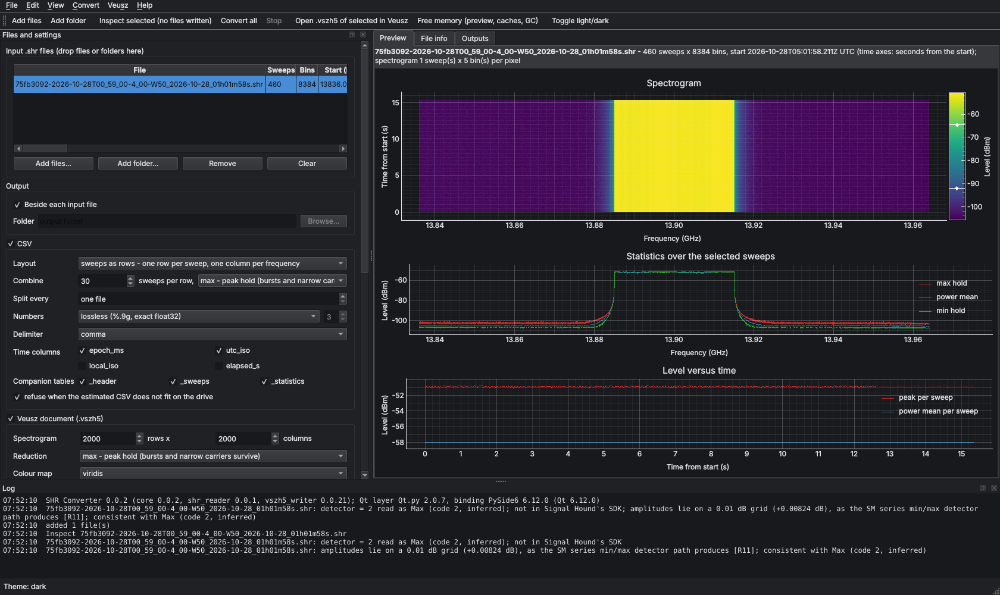
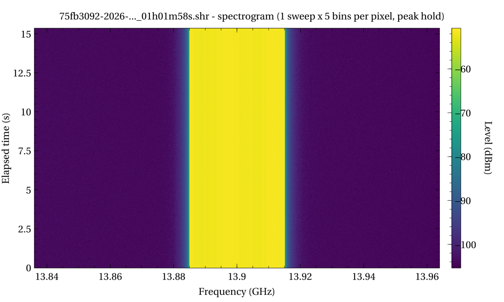
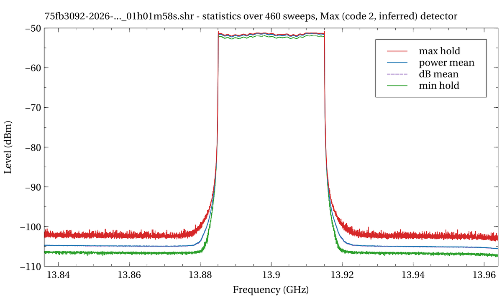

# SHR Converter 0.0.2

A Qt GUI and command-line tool that converts Signal Hound Spike `.shr` sweep recordings into **CSV** files and native **Veusz** documents (`.vszh5`), with optional PDF (bookmarked) and PNG renders.

0.0.2 reads the files with its **own reader, `shr_reader.py` 0.0.1** (NumPy only), built from Signal Hound's SDK definition [1]. py-shr-parser 1.0.0 [9] cannot open recordings made with Spike's Max or Min detector, such as the SM200C recording in `tests/data`. It stops on header byte 352 (`detector = 2`). The new reader keeps every header value and labels unknown ones instead of failing.

Plots are written with **vszh5_writer 0.0.21**. It fixes false blank spectrogram rows that real, jittered time stamps caused (see `docs/WRITER_0.0.21_NOTES.md`).



## What is new in 0.0.2

| Change | Why |
|---|---|
| **`shr_reader.py` replaces py-shr-parser** | Detector code 2 (Max) made py-shr-parser raise `ValueError`. All enumerations are now raw numbers with a label and a confidence ("Max (code 2, inferred)"). Unknown values become notes. |
| **Faster block reads** | Each block of sweeps is one memory-mapped, vectorised read instead of one read per sweep. |
| **Multi-file recordings** (*Join the files of one recording*, `--join`) | Since Spike 3.9.7 a long recording continues in a new file at the maximum file size [2]. Files are grouped by content (same bin axis, times that follow on) and converted as one recording, named `<first file>_joined`. |
| **CSV time decimation** (*Combine N sweeps per row*, `--csv-decimate N`) | 3 h at the SM200C sample's rate is ~10.9 GB of SHR and ~32 GB of lossless CSV. Combining 30 sweeps per row (peak hold, power mean or min) gives ~1 GB. Statistics, spectrogram and `.vszh5` still use every sweep. |
| **Detector shown** on the statistics and header pages; **0.01 dB grid note** | The SM min/max detector path stores values at 0.01 dB resolution [6]; the note confirms the detector reading. |
| **vszh5_writer 0.0.21** | Real Spike time stamps are whole ms with jitter (32–35 ms on the SM200C). 0.0.20 then left a blank spectrogram row every ~47 sweeps. |
| **Display** | Above 10 GHz the frequency axis is shown in GHz (Veusz printed "1.39×10⁴ MHz"). Long Spike file names are shortened in page titles, and long notes wrap on the header page. |
| **Time stamps going backwards** are noted | The PC clock can be adjusted during a recording. |

## Files

| File | Version | Purpose |
|---|---|---|
| `shr_converter.py` | 0.0.2 | Launcher: GUI by default, `--cli`, `--reader`, `--selftest`, `--gui-smoke` (keeps Qt out of the worker processes) |
| `shr_converter_gui.py` | 0.0.2 | Qt.py / PySide6 GUI: menus, toolbar, light/dark/system theme, preview, background tasks |
| `shr_converter_core.py` | 0.0.2 | Engine: CSV, statistics, spectrogram, `.vszh5`, joins, decimation, workers, GPU, command line, self-test |
| `shr_reader.py` | **0.0.1** | The SHR reader: header, tolerant enumerations, salvage, memory-mapped blocks, file sets, grouping, writer, CLI, self-test |
| `vszh5_writer.py` | **0.0.21** | Your Veusz HDF5 writer (drop-in for every program; only `regularize_rows` changed) |
| `tests/test_shr_converter.py`, `tests/test_vszh5_writer.py` | 0.0.2 | pytest suites |
| `tests/long_capture_check.py`, `tests/memory_check.py`, `tests/sm200c_rate_check.py` | 0.0.2 / 0.0.1 / 0.0.1 | 3-hour capture with jittered stamps; memory bound; SM200C-rate multi-file recording |
| `tests/data/75fb3092-…_01h01m58s.shr` | | The SM200C / Spike 4.0 recording (detector code 2), used by the tests |
| `docs/SHR_Converter_Manual_v0.0.2.pdf` (+ `.tex`) | 0.0.2 | LuaLaTeX manual with bookmarks (F1 in the GUI) |
| `docs/WRITER_0.0.21_NOTES.md` | | Writer changes and drop-in results in your other programs |
| `docs/SignalHound_support_letter_2026-10-28.md` / `.txt` | | Draft email to Signal Hound with the open format questions |
| `docs/design/SM200C_SHR_PARSER_BRIEF_0.0.1.md` | | Design record: byte layout, detector evidence, parser evaluation (incl. the Rust parser), test vectors |
| `docs/validation/` | | Every test log of this release (and of 0.0.1) |
| `tools/build_manual.py` | 0.0.2 | Rebuilds the manual with LuaLaTeX; its tables are generated from the code |
| `MANIFEST.sha256` | | SHA-256 of every file (`sha256sum -c MANIFEST.sha256`; Windows: `Get-FileHash -Algorithm SHA256`) |

Every Python file carries your header block, version history and Spyder `# %%` cells.

## Install and run (mamba)

```
mamba env create -f environment.yml          # Python 3.12 + pip packages from requirements.txt
mamba activate shr-converter
mamba install -c conda-forge veusz           # optional: viewer and PDF/PNG render (or the Veusz installer)
mamba install -c conda-forge cupy            # optional: NVIDIA GPU for the statistics
python shr_converter.py                      # GUI (Windows: run_shr_converter.bat)
python shr_converter.py --selftest --gui-smoke
```

py-shr-parser is no longer needed. If it is installed, the tests use it as an independent cross-check on files it can read.

On Windows:
- `create_environment.bat` creates the environment once.
- `run_shr_converter.bat` starts the GUI (you can drop files on it).
- `run_selftest.bat` runs every check, including your SM200C file.

## Using the GUI

1. **Add files** (Ctrl+O), a folder (Ctrl+Shift+O), or drag files onto the window. Each header is read at once, with notes for unusual values (detector code 2, recordings cut short).
2. **Inspect** (Ctrl+I) runs the full statistics pass **without writing anything** and shows the preview. The *File info* tab shows the header, the plan, the CSV size estimate and the free space on the output drive.
3. Choose **CSV > Combine** to write one row per N sweeps. Tick **Selection > Join the files of one recording** for a multi-file Spike recording.
4. **Convert** (F5 converts every file, Shift+F5 the selected ones). **Stop** (Esc) stops after the current block and deletes that file's partial outputs.
5. **Veusz > Open** (Ctrl+Shift+Z) opens the document in Veusz; **Render** (Ctrl+R) writes the PDF and PNGs.

Menus: File, Edit, View (**Theme: System / Light / Dark**, Ctrl+T toggles), Convert, Veusz, Help (F1 manual, shortcuts, About).





## Outputs

| File | Content |
|---|---|
| `<name>.csv` (or `<name>_part001.csv`, …) | Amplitudes, in one of three layouts (below) |
| `<name>_header.csv` | Every header field with its unit (enumerations as labels), derived values, the files of a joined recording, CSV parts, decimation, versions, notes |
| `<name>_sweeps.csv` | One row per sweep: time, GPS, ADC overflow, peak, peak frequency, power mean over the band |
| `<name>_statistics.csv` | One row per bin: max hold, min hold, power mean, dB mean, standard deviation, count |
| `<name>.vszh5` | Pages: spectrogram, statistics, selected sweeps, level versus time, GPS track (if any), file header |
| `<name>.pdf`, `<name>_pNN_<page>.png` | Optional render: PDF with a bookmark tree, PNGs on white |

A joined recording is named `<first file>_joined.*`.

| CSV layout | Rows × columns | Use |
|---|---|---|
| `sweeps_as_rows` (default) | one row per sweep: index, times, [sweeps_combined], GPS, overflow, then one column per frequency | MATLAB, pandas, Veusz |
| `frequencies_as_rows` | one row per bin: frequency, then one column per sweep (or group) | short captures |
| `long` | one row per sample: index, times, [sweeps_combined], frequency, amplitude | databases, tidy data |

**Number format.** Numbers are lossless by default: `%.9g` round-trips every float32 exactly [5]. CSV values were checked bit for bit against direct reads of your SM200C file and of Spike's `sweep0v2.shr`.

**Fixed decimals.** These give smaller files. SM min/max recordings, however, lie on a 0.01 dB grid shifted by a constant (+0.00824 dB in your file), so 2 decimals move every value by up to 0.005 dB.

**CSV decimation.** With `csv_decimate` = N, each row carries:
- the index and time of the **first** sweep of its group;
- the first GPS fix;
- ADC overflow if any sweep in the group overflowed;
- a `sweeps_combined` column.

## Long captures and SM200C data rates

| Recording | SHR size | Lossless CSV | With `--csv-decimate 30` |
|---|---|---|---|
| Your SM200C sample: 15.3 s at 29.9 sweeps/s × 8384 bins | 14.7 MiB | 43.8 MiB | 1.7 MiB (16 rows) |
| 3 h at that rate (323 000 sweeps, estimate) | 10.9 GB, at least 11 files of 1 GB | ~32.5 GB | ~1.1 GB |
| 3 h at 2 sweeps/s × 4001 bins (synthetic) | 331 MiB | 981 MiB (7 files of 30 min) | — |

Other features for long captures:
- **CSV split by time.**
- **Disk-space check:** the conversion refuses to start when the CSV cannot fit.
- **Memory-mapped per-sweep table.**
- **Peak-hold thinning of the Veusz time series:** every burst survives.
- **Even-grid spectrogram:** pauses and limit-line-triggered gaps show as blank bands, with no false gaps since writer 0.0.21.

## Performance and memory (measured on 2 CPU cores, no GPU)

| Case | Time | Peak memory (all processes) |
|---|---|---|
| SM200C sample, CSV + companions + `.vszh5` | 1.6 s | – |
| 3 h at 2 sweeps/s × 4001 bins, 1.5 ms jitter, CSV in 7 files + PDF/PNG render | 27.9 s (2 workers) | 0.86 GiB |
| 3 h at 50 sweeps/s × 512 bins (540 000 sweeps), CSV in 7 files | 58.9 s (2 workers) | 0.56 GiB |
| SM200C rate, 2 files × 10 min (1.1 GiB, 35 902 sweeps), joined, decimate 30 | 11.4 s (2 workers, 100 MiB/s of SHR) | 0.48 GiB |
| 1500 × 65 536 bins, RAM budget 256 MB, CSV 1.1 GiB | 21.4 s (2 workers) | 0.42 GiB |

From the SM200C-rate run, a 3-hour SM200C recording with `--csv-decimate 30` would take about 2 minutes on 2 cores. Your i9 has many more cores. The logs are in `docs/validation/`.

**Parallelism.**
- Blocks of sweeps are read, formatted and reduced in worker processes started with *spawn*, so a GUI is never forked.
- Results merge exactly and in order, with at most 2 × workers blocks in flight.
- Each worker memory-maps the file itself.
- Default workers = CPUs − 1, at most 61 on Windows.

**GPU.** With CuPy and a CUDA device, the statistics and the spectrogram reduction run on the GPU in 2 M-sample sub-blocks. Any GPU error repeats that block on the CPU.

**Memory.** *Edit > Free memory* (Ctrl+Shift+M) frees it on demand. Previews are pickled to disk, and memory is flushed after each file.

## Command line

```
python shr_converter.py --cli capture.shr -o out --split-minutes 30 --render
python shr_converter.py --cli rec_1.shr rec_2.shr rec_3.shr --join --csv-decimate 30 -j 8
python shr_converter.py --cli folder_of_shr/ --layout long --fixed 2 --sweeps 0:0:10 --freq 13880:13920
python shr_converter.py --cli --info --join folder_of_shr/   # grouping, header and plan only
python shr_converter.py --reader capture.shr --grid          # the reader's own description
python shr_converter.py --cli --help                         # every option
```

## The reader (`shr_reader.py`)

The file layout is the packed SDK struct [1]:
- a 472-byte file header;
- per sweep, a 48-byte sweep header (time stamp, latitude, longitude, altitude, ADC overflow, reserved) followed by `sweepLength` float32 values.

Every field is decoded. Enumerations are kept as raw numbers and labelled:

| Field | Codes (SDK) | Also read |
|---|---|---|
| detector | 0 MinMax, 1 Average | **2 Max (inferred)**, 3 Min (unverified) |
| ref_scale | 0 dBm, 1 mV | others: noted, treated as dB |
| window, processing_units, decimation_type/_detector, channel_output_units | as in the SDK | others: "unknown (code n)" + note |

**Salvage.** When the header count is 0, or exceeds the sweeps present (a recording cut short), the reader uses the complete sweeps and reports any trailing bytes. A `dataOffset` beyond 472 is honoured, file version 1 is read, and version > 2 is read with a note.

**`ShrFileSet`** reads the files of one recording as one, with continuous sweep numbers and the gaps between files reported. **`group_recordings()`** decides which files belong together.

The reader has its own 39-check self-test (`python shr_reader.py --selftest`).

## Statistics (what the numbers mean)

| Quantity | Definition (x = level of a bin in one sweep) |
|---|---|
| Max / min hold | max / min of x over the selected sweeps |
| Power mean (dBm) | $10\log_{10}\big(\tfrac1N\sum_k 10^{x_k/10}\big)$, in linear power |
| dB mean (dBm) | $\tfrac1N\sum_k x_k$; reads about 2.51 dB low for noise [4] |
| RMS (mV files) | $\sqrt{\tfrac1N\sum_k x_k^2}$ |
| Band power mean per sweep | power mean over the selected bins: a mean power per bin, **not** a channel power |
| Frequency of bin i | first_bin_freq_hz + i · bin_size_hz (from the header; not centre ± span/2) |

With a **Max detector**, each stored value is already a max hold of many FFTs (about 512 in your file), so these statistics describe the recorded values. Use the Average detector with Power units for noise power, as Spike's own help advises for noise markers [3].

## Data gaps and confidence

| Item | Status | Confidence |
|---|---|---|
| SM200C / Spike 4.0 recording, detector code 2 | Read and converted bit-exact. Code 2 = Max inferred from the 0.01 dB grid and the noise statistics. | High for the data; inferred label (letter to Signal Hound drafted) |
| Spike's `sweep0v2.shr` | Bit-exact against py-shr-parser: header, all 417 sweeps, time stamps | High |
| Detector code 3 (Min), Min/Max content | Not seen in a file | Unverified; please record test files |
| Multi-file naming, limit-line-triggered and channelized recordings, time decimation stamps | Undocumented; grouping is by content; tested with synthetic sets only | Medium; questions in the letter |
| mV recordings, titles | Synthetic only (title decoded as UTF-16LE per the SDK's `uint16_t title[128]`) | Medium |
| GPU path | NumPy stand-in, including the out-of-memory fallback | Medium |
| Windows | Written for it (spawn, 61-worker limit, memory maps closed explicitly, locked-CSV fallback). Tested on Linux only | Medium; run `run_selftest.bat` on txrx03 |

## References

| # | Reference (IEEE) | URL |
|---|---|---|
| [1] | Signal Hound, "SHR parsing example" (shr_parse.h, shr_parse.cpp), in Signal Hound Software Development Kit, release of Oct. 5, 2026. | https://signalhound.com/software/signal-hound-software-development-kit-sdk/ |
| [2] | Signal Hound, "Technical Software and Hardware Change Log" (Spike), v4.0.17, Sep. 21, 2026. | https://signalhound.com/sigdownloads/Spike/change_log.txt |
| [3] | Signal Hound, "Spike Software Documentation" (Sweep Record and Playback; Noise markers). | https://signalhound.com/sigdownloads/Spike/docs/html/index.html |
| [4] | Hewlett-Packard, "Measuring Noise and Noise-like Digital Communications Signals with a Spectrum Analyzer," Application Note 1303, lit. no. 5966-4008E. | https://www.hpmemoryproject.org/an/pdf/an_1303.pdf |
| [5] | IEEE, "IEEE Standard for Floating-Point Arithmetic," IEEE Std 754-2019, pp. 1–84, Jul. 2019, doi: 10.1109/IEEESTD.2019.8766229. | https://doi.org/10.1109/IEEESTD.2019.8766229 |
| [6] | Signal Hound, "SM200A/B/C – SM435B/C Product Manual," Jan. 27, 2025. | https://signalhound.com/sigdownloads/SM200A/SM-User-Manual.pdf |
| [7] | A. Wunderlich and A. Sanders, "The expected peak-to-average power ratio of white Gaussian noise in sampled I/Q data," *IEEE Trans. Instrum. Meas.*, 2025, doi: 10.1109/TIM.2025.3544288. | https://doi.org/10.1109/TIM.2025.3544288 |
| [8] | NIST/SEMATECH, "1.3.6.6.16 Extreme Value Type I Distribution," *e-Handbook of Statistical Methods*. | https://itl.nist.gov/div898/handbook/eda/section3/eda366g.htm |
| [9] | T. Schmitz, "py-shr-parser," v1.0.0, WiSE Lab, Carnegie Mellon Univ., 2025. | https://github.com/WiseLabCMU/py-shr-parser |
| [10] | Signal Hound Forums, ".shr file format specification," BB Series Discussions, 2018. | https://signalhound.com/?p=158701 |
| [11] | Microsoft, "Excel specifications and limits." | https://support.microsoft.com/en-us/office/1672b34d-7043-467e-8e27-269d656771c3 |
| [12] | Python Software Foundation, "concurrent.futures — Launching parallel tasks," Python 3.12 docs. | https://docs.python.org/3.12/library/concurrent.futures.html |
| [13] | Preferred Networks, "CuPy documentation." | https://docs.cupy.dev/ |
| [14] | J. Sanders, "Veusz — a scientific plotting package." | https://veusz.github.io/ |
| [15] | M. Ottosson *et al.*, "Qt.py," v2.0.7. | https://github.com/mottosso/Qt.py |
