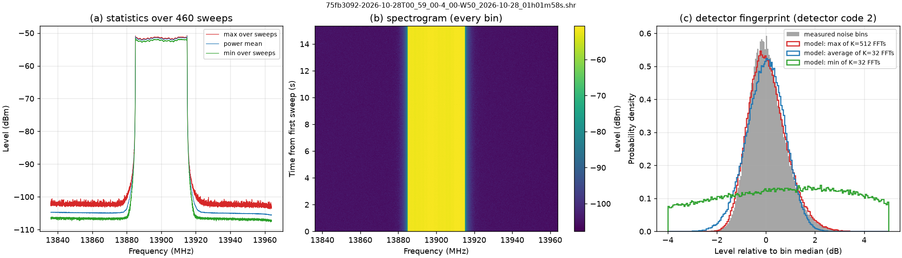

# SM200C / Spike 4.0 SHR recordings: reader design brief 0.0.1

> **Implemented** in `shr_reader.py` 0.0.1 and SHR Converter 0.0.2 (same day). Kept here as the design record: byte layout, detector evidence, parser evaluation, test vectors. Paths in section 10 refer to the separate `SM200C_SHR_reader_prep_2026-10-28` folder.

## 0. Summary

| Question | Answer | Confidence |
|---|---|---|
| Why does Inspect fail? | py-shr-parser 1.0.0 converts header field `detector` (offset 352) into a strict `IntEnum` that knows only 0 (MinMax) and 1 (Average). The SM200C file has **2**, so `ValueError: 2 is not a valid ShrVideoDetector` is raised in `ShrFileHeader.from_tuple()`, before any sweep is read. | Verified (traceback reproduced) |
| Is the file itself sound? | Yes. Signature 0xAA10, version 2, `dataOffset` 472, 460 sweeps × 8384 bins. The size matches the header exactly (472 + 460 × 33 584 = 15 449 112 B). All amplitudes are finite, time stamps are monotonic, and the reserved bytes are zero. | Verified |
| Has the layout changed? | No. The layout is identical to Signal Hound's own SDK definition (`shr_parse.h`, file version 2, shipped unchanged in the 2026-10-05 SDK). Only the **value range** of `detector` grew. | Verified |
| What is detector 2? | **Max** (Spike added "max and min detectors" in 3.5.7, 2020-07-22; the SDK header was never updated). Two independent tests (§4) agree. Code 3 is presumably Min; not verified. | High for 2 = Max (inferred from data); 3 unverified |
| Use an existing module? | **No.** py-shr-parser fails. The Rust `shr-parser` wheel opens the file but gives only one summary number per sweep, panics on a cut-short file, and needs about twice the file size in RAM (§5). | Verified by test |
| Plan | Write a small, dependency-free NumPy reader, `shr_reader.py`: a memory-mapped structured dtype that tolerates unknown enum values, salvages cut-short files and handles multi-file sets. Swap it into SHR Converter 0.0.2. | Recommendation |
| Scale warning | At this file's settings (29.9 sweeps/s × 8384 bins) a **3-hour recording is about 10.9 GB** of SHR (323 000 sweeps). Spike splits it into several files, and a lossless CSV of every bin would be about **32.5 GB**. | Computed |



*Figure 1 - Sample `75fb3092-…_01h01m58s.shr`. (a) max, power-mean and min over 460 sweeps; a flat signal about 30 MHz wide at 13.900 GHz, near −51 dBm. (b) Spectrogram, every bin. (c) dB distribution of noise-only bins against detector models; it matches the max of K = 512 FFTs.*

---

## 1. The failure, exactly

```
File ".../shr_parser/shr_parser.py", line 141, in _open_file
    self.__header.from_tuple(struct.unpack(FILE_HEADER_PACK, bytes_read))
File ".../shr_parser/metadata.py", line 114, in from_tuple
    self.detector = ShrVideoDetector(d[19])
ValueError: 2 is not a valid ShrVideoDetector
```

* `shr_converter_core.open_parser()` calls `ShrFileParser.open()`, which re-raises the exception. Inspect, Convert and the CLI all fail at the same point.
* Every other enum conversion in `metadata.py` is just as strict: `ShrScale`, `ShrWindow`, `ShrVideoUnits`, `ShrDecimationType`, `ShrDecimationDetector` and `ShrChannelizerOutputUnits`. The next value Spike adds to any of them breaks the parser again. That is the main argument against patching one enum.

## 2. The sample file

| Item | Value |
|---|---|
| File | `75fb3092-2026-10-28T00_59_00-4_00-W50_2026-10-28_01h01m58s.shr` |
| Size, SHA-256 | 15 449 112 B, `6bceea36dbde216c9e0242a9ddf54ae3f86980b79c1931ee3cb3ca3e25339c51` |
| Instrument / software | SM200C, Spike 4.0.x as you reported (the change log's latest is 4.0.17, 2026-09-21). The file stores no Spike version. |
| Sweeps × bins | 460 × 8384 (`sweepLength`) |
| Time | 2026-10-28T05:01:58.211Z to 05:02:13.552Z (15.341 s). Δt 32 to 35 ms, median 33 ms, giving **29.92 sweeps/s**. The file name's local time 01h01m58s (UTC−4) matches the first stamp. |
| Frequency axis | first bin 13 836.029 052 734 MHz, bin 15 258.789 0625 Hz, last bin 13 963.943 481 MHz |
| Centre / span | 13 900 MHz / 128 MHz. The first bin lies 29 052.7 Hz (1.90 bins) above centre − span/2, and the bins cover 127.93 MHz. **Always use `firstBinFreqHz + i·binSizeHz`**, never centre ± span/2. |
| RBW / VBW | 30 kHz / 30 kHz. Check: `rbwHz = windowBandwidth × binSizeHz` = 1.96608 × 15 258.789 = 30 000.0 Hz exactly |
| Ref level / scale / div | −20 dBm / dBm (0) / 10 dB |
| Window / atten / gain | Nuttall (0) / 0 / 0 (raw values; the meaning of 0 for the SM200C, e.g. auto, is not documented) |
| Detector / video units | **2 (not in SDK)** / Power (2) |
| Decimation | Count (1), Average (0), count 1, i.e. **none**. `decimationTimeMs` 40 is a stale setting and unused. |
| Channelizer | off (0). The channel centre 100 MHz and width 20 MHz are stale settings. |
| GPS / ADC overflow | all zero / no overflow in any sweep |
| Amplitudes | −107.702 to −50.722 dBm. **4 999 distinct values in 3 856 640 samples**, all on a 0.01 dB grid plus a constant +0.00824 dB (§4.1). |

## 3. Verified file layout (version 2)

Source: Signal Hound SDK `shr_parser/shr_parse.h` [2] (`#pragma pack(1)`, little endian). It was checked byte by byte against the sample and against Spike's `sweep0v2.shr`.

### 3.1 `SHRFileHeader`, 472 bytes at offset 0

| Offset | Field | C type | struct | Sample value | Notes |
|---|---|---|---|---|---|
| 0 | signature | uint16 | H | 43536 = 0xAA10 | must match |
| 2 | version | uint16 | H | 2 | 1 = initial; 2 = ADC overflow byte added to the sweep header |
| 4 | reserved1 | uint32 | L | 0 | |
| 8 | dataOffset | uint64 | Q | 472 | SDK: "may not always be the case. Use the data offset." |
| 16 | sweepCount | uint32 | L | 460 | can be stale or 0 if a recording was not closed |
| 20 | sweepLength | uint32 | L | 8384 | bins per sweep |
| 24 | firstBinFreqHz | double | d | 13 836 029 052.734 375 | |
| 32 | binSizeHz | double | d | 15 258.789 0625 | |
| 40 | title | uint16[128] | 256s | "" | UTF-16LE, 127 characters + NUL |
| 296 | centerFreqHz | double | d | 13.9e9 | |
| 304 | spanHz | double | d | 128e6 | |
| 312 | rbwHz | double | d | 30 000 | |
| 320 | vbwHz | double | d | 30 000 | |
| 328 | refLevel | float | f | −20 | dBm or mV by `refScale` |
| 332 | refScale | uint32 | L | 0 | enum (§3.3) |
| 336 | div | float | f | 10 | |
| 340 | window | uint32 | L | 0 | enum |
| 344 | attenuation | int32 | l | 0 | |
| 348 | gain | int32 | l | 0 | |
| 352 | detector | int32 | l | **2** | enum, the field that breaks py-shr-parser |
| 356 | processingUnits | int32 | l | 2 | enum |
| 360 | windowBandwidth | double | d | 1.96608 | in bins |
| 368 | decimationType | int32 | l | 1 | enum |
| 372 | decimationDetector | int32 | l | 0 | enum |
| 376 | decimationCount | int32 | l | 1 | |
| 380 | decimationTimeMs | int32 | l | 40 | |
| 384 | channelizeEnabled | int32 | l | 0 | 1 = on |
| 388 | channelOutputUnits | int32 | l | 0 | enum |
| 392 | channelCenterHz | double | d | 100e6 | |
| 400 | channelWidthHz | double | d | 20e6 | |
| 408 | reserved2 | uint32[16] | 64s | all 0 | watch for future use |

### 3.2 Each sweep at `dataOffset + n·(48 + 4·sweepLength)`

| Offset | Field | Type | Notes |
|---|---|---|---|
| 0 | timestamp | uint64 | ms since Unix epoch. System clock per Signal Hound (2018 forum [9]); the 2026 help says GPS can supply time stamps [4], so the source is ambiguous. |
| 8 | latitude | double | 0 without GPS |
| 16 | longitude | double | |
| 24 | altitude | double | metres |
| 32 | adcOverflow | uint8 | version ≥ 2 (IF overload, Spike 3.2.9); a reserved byte in version 1 |
| 33 | reserved | uint8[15] | all 0 in the sample |
| 48 | amplitudes | float32[sweepLength] | dBm (or mV when refScale = 1) |

NumPy record for one sweep: `[("timestamp_ms","<u8"),("latitude","<f8"),("longitude","<f8"),("altitude_m","<f8"),("adc_overflow","u1"),("reserved","u1",15),("amplitude","<f4",N)]`, itemsize 48 + 4N.

### 3.3 Enumerations

| Field | SDK `shr_parse.h` (2019) [2] | Spike 4.0 SCPI names [5] | Seen in files | Reader policy |
|---|---|---|---|---|
| refScale | 0 dBm, 1 mV | | 0 | keep raw + name; unknown → note, amplitude unit shown as "unknown" |
| window | 0 Nuttall, 1 Flattop, 2 Gaussian | | 0 | keep raw + name |
| **detector** | 0 MinMax, 1 Average | AVERage, MINMAX, MIN, MAX | **2** | 2 → "Max (inferred)"; 3 → "Min (unverified)"; others "unknown(n)" |
| processingUnits | 0 Log, 1 Voltage, 2 Power, 3 Sample | POWer, SAMPle, VOLTage, LOG | 2 | keep raw + name |
| decimationType | 0 Time, 1 Count | TIME, COUNT | 1 | keep raw + name |
| decimationDetector | 0 Average, 1 Max | AVERage, MAX | 0 | keep raw + name |
| channelOutputUnits | 0 dBm, 1 dBm/Hz | DBM, DBMHZ | 0 | keep raw + name |

The SCPI order (AVER, MINMAX, MIN, MAX) differs from the file codes (MinMax = 0, Average = 1), so it cannot be used to infer codes 2 and 3.

## 4. Evidence that detector 2 = Max

### 4.1 Test 1: amplitude grid (independent of statistics)

The SM product manual [6] says that, for min/max processing, "the FFT is converted to 0.01 dB resolution, and processed through a min hold and max hold trace buffer"; the average path sums linear power. In the sample, each of the 4 999 distinct values satisfies

$$ x = 0.01\,k + 0.00824\ \text{dB}, \qquad k\in\mathbb{Z}, $$

with a largest residual of $7.3\times10^{-6}$ dB, which is float32 precision. An average-detector file would have values spread continuously. The samples therefore came through the **min/max path**, so the detector is MinMax, Min or Max, not Average.

Caveat: the manual describes this quantisation for the **real-time** trace buffer. The file does not record whether Spike was in sweep or real-time mode; recording works in both [4]. This file's settings (RBW 30 kHz, span 128 MHz, start 13.836 GHz) meet the manual's conditions for FPGA real-time processing (RBW ≥ 30 kHz, span ≤ 160 MHz, start ≥ 650 MHz) [6], so it may have been recorded in real-time mode.

### 4.2 Test 2: shape of the noise distribution

In a noise-only bin the power of one FFT is exponentially distributed (χ² with 2 degrees of freedom) [15], [16]. With $K$ overlapping FFTs per bin per sweep, unit mean:

* **Max**: $P(M\le x)=\left(1-e^{-x}\right)^K$, $\;E[M]=H_K=\sum_{k=1}^{K}1/k\approx\ln K+\gamma$ [13]. For large $K$, $M-\ln K$ tends to the Gumbel distribution, with standard deviation $\pi/\sqrt6\approx1.283$ and skewness $+1.14$ [14]. In dB, $Y=10\log_{10}M$, so $\sigma_Y\approx\frac{10}{\ln10}\,\frac{\delta M}{M}\approx\frac{4.343\times1.283}{\ln K+\gamma}$. For $K=512$ this gives $\sigma_Y\approx0.82$ dB, and the distribution is skewed to the right.
* **Min**: $\min_i X_i\sim\text{Exp}(K)$, which is the same shape for every $K$. In dB, $\sigma_Y=\frac{10}{\ln10}\frac{\pi}{\sqrt6}=5.57$ dB, with a long lower tail.
* **Average** (power): $\bar X\sim\Gamma(K,1/K)$, so $\sigma_Y\approx4.343/\sqrt K$, with slight **negative** skew.

Each noise bin (5 998 bins never within 8 dB of a carrier, 2.76 M samples) was referred to its own median, and the sweep-to-sweep level was removed. The result, against Monte-Carlo models (100 000 draws each):

| Data / model | σ (dB) | skew | p50 − p1 (dB) | p99 − p50 (dB) | p99.9 − p50 (dB) |
|---|---|---|---|---|---|
| **Measured** | **0.745** | **+0.51** | **1.43** | **2.12** | **3.02** |
| max, K = 512 | 0.77 | +0.50 | 1.47 | 2.14 | 3.00 |
| max, K = 1024 | 0.70 | +0.55 | 1.29 | 1.97 | 2.76 |
| average, K = 32 | 0.77 | −0.17 | 1.91 | 1.68 | 2.21 |
| average, K = 1024 | 0.14 | −0.03 | 0.32 | 0.31 | 0.42 |
| min, any K | 5.57 | −1.15 | 18.4 | 8.2 | 9.9 |

Only max-type models produce the positive skew. Combined with the 0.01 dB grid, the stored trace is a **max hold over about 500 to 1000 FFTs**, which is what detector "Max" means. MinMax (code 0 in the SDK) might store the max array as well, so recordings in all four modes (§9) are still needed to fix codes 2 and 3 and to learn what MinMax stores.

Rough plausibility check (unverified): a bin of 15.259 kHz implies a 65.5 µs FFT, which advances every 32.8 µs at 50 % overlap [6]. K ≈ 512 is then about 17 ms of data per sweep, against a 33 ms sweep period.

## 5. Existing parsers evaluated

| Option | Opens this SM200C file? | Per-bin data | Header access | Unknown enum values | Cut-short file | RAM for a 3-h, ~11 GB recording | Maintenance | Licence | Verdict |
|---|---|---|---|---|---|---|---|---|---|
| **py-shr-parser 1.0.0** (T. Schmitz, CMU; PyPI 2025-07-24) [10] | **No**: `ValueError` | yes (seek + read per sweep) | structured object | raises on all 7 enums | raises `ShrFileParserWarning` (converter salvages) | small (one sweep) | last commit 2025-07-28 | BSD-3 | **Fails**; patching means a fork |
| **shr-parser 0.1.9 wheel** (Rust crate 1.0.8, L. Nielsen; PyPI 2025-02-04) [11], [12] | **Yes** (detector read as a raw int) | **No**: one summary number per sweep (PEAK, MEAN or LOW) | Rust debug **text string** only (title as a list of uint16) | detector 2 accepted (tested); in the GitHub-head source detector and window are raw, refScale and decimation fields strict | **Rust panic** (`PanicException`, a `BaseException`, escapes `except Exception`) | **≈ 2× file size** (measured: 673 MiB per 331 MiB; 2.2 GB per 1.08 GB) → about 22 GB | README: "No longer actively maintained … will probably be archived" | GPL-3.0-**only** | **Not usable** for conversion |
| Rust GitHub head (crate 2.0.0 + binding 0.1.10; **unreleased**, merged 2026-10-28) [11], [12] | probably (detector raw `i32`); not built or run | `get_data()` → Python **list of (Hz, amplitude) tuples** | debug text | as above | returns an error "SHR file is truncated" (no salvage) | estimated from source: `fs::read` of the whole file + 16 B per bin + a full copy in `get_sweeps()` ≈ **≥ 9× file size** | needs a Rust toolchain and maturin; Python binding path-depends on the crate | GPL-3.0-only | **No** |
| Signal Hound SDK C++ example (`shr_parse.h/.cpp`, 2018–19, in the 2026-10-05 SDK) [2] | yes (no enum checks) | yes | raw struct | raw | no checks | one sweep | reference only | SDK licence | Authoritative layout. Note: `SHRGetSweep()`'s return value is **always false**, because it compares the float bytes read with a size that includes the 48-byte header. |
| **Own NumPy reader** (proposed) | yes (the diagnostic already reads it this way) | memory-mapped blocks | structured dataclass, raw + names | raw + name + note, never raises | salvages complete sweeps | file-backed pages; bounded blocks | ours | GPL-3.0-or-later | **Recommended** |

Rust wheel results (`analysis/results/rust_eval_results.txt`):

| Check | SM200C sample | Spike `sweep0v2.shr` |
|---|---|---|
| Opens | yes, 460 sweeps | yes, 417 sweeps |
| PEAK / LOW value + frequency, time stamps | all equal to the direct read | all equal |
| MEAN | arithmetic mean of **dB** values in float32, reported at the centre bin. Sweep 0: **−91.72 dBm vs power mean −58.04 dBm** (33.7 dB apart) | −79.64 vs −71.97 dBm |
| Cut-short copy | `PanicException` from `unwrap()` on EOF inside Rayon workers | |
| Header count = 0 | opens with 0 sweeps (data ignored) | |
| 331 MiB / 1.08 GB synthetic 3-h captures | 0.4 s / 1.5 s on a repeat run (first run 24 s / 81 s, probably a cold disk cache); peak RSS 673 MiB / 2 206 MiB, both runs | |
| NumPy structured memmap, same files (per-sweep peak in 4096-sweep blocks) | 0.1 s / 0.3 s on a repeat run. RSS 356 / 1 109 MiB is the mapped file pages, which is page cache the OS can drop, not allocated memory | |

**Conclusion on the Rust parser:** its values are correct and it is fast once the file is cached, but it is not worth adopting:
* The released version cannot return the bins.
* The version that can is unreleased, unmaintained, would have to be built from source, and turns every 4-byte value into about 112 bytes of Python objects.
* It panics on interrupted recordings.
* Its GPL-3.0-only licence would pin the converter to GPL-3.0-only.

Keep it, at most, as an optional independent cross-check in the test suite (separate environment, because both packages import as `shr_parser`).

Also checked: sigmf-python 1.15.0 converts Spike **zero-span I/Q** recordings (`.xml` + `.iq`), not `.shr` sweep files [17].

## 6. Spike behaviours a reader must handle

| Spike version (date) | Change [3] | Effect on the reader |
|---|---|---|
| 3.1.13 (2018-03-19) | SHR introduced; time decimation (avg/max over N sweeps or T s); channelizer; GPS position per sweep | decimation and channelizer fields; GPS fields |
| 3.2.0 (2018-05-08) | custom file-name prefix | names cannot be parsed for meaning |
| 3.2.9 (2019-03-04) | IF overload stored in recordings | `adcOverflow` (file version 2) |
| **3.5.7 (2020-07-22)** | **max and min detectors added** to sweep and real-time modes | **detector codes beyond 0/1**; breaks py-shr-parser |
| 3.9.7 (2024-09-03) | **multi-file sweep recording** | sets of files: "a new sequentially numbered file is created when the max file size is reached" [4]; the naming scheme is not documented |
| 4.0.1 (2025-02-11), 4.0.16 (2026-08-03) | file-size limit fixes | |
| **4.0.17 (2026-09-21)** | **limit-line triggering when sweep recording** | "only the sweeps that contain data that exceed the limit lines are saved" [4], so time stamps will have **gaps**. The converter's `regularize_rows()` already blanks pauses. |

The maximum file size is set in whole GB (`REC:SWE:FILE:SIZE:MAX <int>`, SCPI [5]). A 3-h recording at this file's rate (about 10.9 GB) is therefore at least 11 files at the 1 GB setting.

## 7. Design of `shr_reader.py` 0.0.1 (to code next week)

Requirements in priority order, with no code yet:

1. **No third-party SHR dependency.** `struct` for the header, NumPy `memmap` with the record dtype of §3.2 for sweeps, and bounded block reads (no Python loop per sweep). On this file a block read is about 1.7× faster than per-sweep seek+read (4.4 vs 7.7 ms, warm cache). The gain grows when there are few bins per sweep.
2. **Never fail on enum values.** Keep each raw integer, give a name where known, and use `unknown(n)` otherwise. Add a note per unknown field, and flag inferred names ("Max (inferred)").
3. **Validation and salvage**, matching what the converter's `open_parser()` does now:
   * Check the signature.
   * Version ≤ 2: read normally. Version > 2: try with a warning.
   * Use `dataOffset` as given, but require ≥ 472.
   * Require `sweepLength` > 0, and `binSizeHz` > 0 and finite.
   * Count complete sweeps from the file size. Header count 0 means use the size; a header count above the complete count means truncate; report trailing bytes.
   * Warn on non-monotonic time stamps and non-finite amplitudes.
4. **Header object** (`ShrHeader` dataclass): every field of §3.1 under the SDK names, plus `title` decoded as UTF-16LE up to the NUL, and derived values: `frequency_hz()`, `amplitude_unit`, `is_db`, `detector_name`, `stated_sweep_count`.
5. **File object** (`ShrFile`): `open(path)`, context manager, `n_sweeps`, `notes`.
   * `read(start, stop, step=1, col0=0, col1=None)` returns `(amplitudes float32 [n, bins], sweep_headers structured [n])`.
   * Also `iter_blocks(block_sweeps)`, `timestamps_ms()` and `close()`.
   * Picklable by path, so that each spawn worker opens its own memmap.
   * On Windows, an open memmap locks the file: close or `del` the maps before renaming or deleting.
6. **File sets** (`ShrFileSet`): group the files of one multi-file recording. The ordering rule is to be fixed from a real set, with time stamps as fallback. Check that the headers are compatible (bins, first bin, bin size, RBW, detector, units, scale), index continuously across files, and report gaps between files.
7. **Version-1 files:** treat `adcOverflow` as unknown (the reserved byte).
8. **Title:** UTF-16LE (the converter's `decode_title()` already does this).

Integration into **SHR Converter 0.0.2**. Touchpoints in `shr_converter_core.py` 0.0.1:

| Lines | Now | Change |
|---|---|---|
| 278–286 | `import shr_parser …` | import `shr_reader`; py-shr-parser becomes optional (tests only) |
| 564–620 | `_require_parser`, `open_parser()` | replaced by `shr_reader.ShrFile.open()` (same notes) |
| 622–647 | `read_info()` | reads `ShrHeader`; header table shows raw + name for every enum |
| 1047–1055, 1206, 1277–1282, 1753–1755, 2300–2304, 2509–2511, 2720–2722 | `get_sweep_n()` per sweep | block reads `read(start, stop, step, col0, col1)` |
| 2457–2475 | synthetic writer uses py-shr-parser's struct strings | own `HEADER_PACK` / record dtype; add `detector=` and `version=` arguments |
| 2043, 2218, 2363, 2780 | "py-shr-parser x.y" in generator strings | "shr_reader 0.0.1" |
| tests/test_shr_converter.py:101, tools/build_manual.py:132 | py-shr-parser references | update |

Feature notes for 0.0.2 that follow from this file:
* The **header page and labels** state the detector ("statistics of max-detected sweeps").
* **Fixed-decimal CSV:** with this file's +0.00824 dB grid offset, 2 decimals moves every value by up to 0.005 dB. Lossless `%.9g` (the default) is unaffected.
* **Volume:** 3 h at 29.9 sweeps/s × 8384 bins is 10.9 GB of SHR. The CSV estimate is 32.5 GB lossless, 21.7 GB at 2 decimals. Options:
  * **Spike-side time decimation** (e.g. 1 s max hold: 10 800 sweeps, 0.36 GB);
  * a new converter-side **time decimation** (max/average over N sweeps or T s), alongside the existing sweep step and frequency range;
  * CSV of a frequency sub-range only.
* **GUI:** accept a multi-file set as one recording.
* **Versions:** `shr_reader.py` 0.0.1 (new); `shr_converter*.py` 0.0.2; `vszh5_writer.py` stays 0.0.20.

## 8. Test plan and test vectors

From `analysis/results/test_vectors.json` (sample file):

| Quantity | Expected |
|---|---|
| header | §3.1 "Sample value" column; detector 2 → "Max (inferred)", no exception |
| sweep 0 time stamp / last | 1 793 163 718 211 ms / 1 793 163 733 552 ms |
| sweep 0, bins 0–7 (dBm) | −105.34175110, −105.02175903, −104.08175659, −104.57176208, −105.19175720, −104.52175903, −104.55175781, −104.79174805 |
| last sweep, last 4 bins (dBm) | −106.05175781, −105.45175171, −105.93176270, −106.63175964 |
| max over all sweeps | −50.721756 dBm at bin 5174 = 13 914.978 027 MHz |
| median power-mean floor | −104.83 dBm |
| amplitude grid | 0.01 dB steps + 0.00824 dB; 4 999 distinct values |

Test cases:

1. Sample: header, vectors and grid as above.
2. `sweep0v2.shr` (Spike test file in py-shr-parser): bit-exact against py-shr-parser, which opens it.
3. Synthetic files covering:
   * every enum field set to an unknown value;
   * version 1;
   * `dataOffset` > 472;
   * `sweepCount` 0;
   * cut mid-sweep;
   * trailing bytes;
   * UTF-16 non-ASCII title;
   * mV scale;
   * NaN amplitudes;
   * time stamps going backwards;
   * a two-file set, with and without matching headers.
4. Scale: a synthetic 3-h, 11 GB set (3 × 3.7 GB files). Peak RAM must stay bounded by the converter's budget, and throughput is measured.
5. Windows (your Minisforum i9): spawn workers; files can be renamed and deleted after `close()`.
6. Optional: Rust wheel cross-check of PEAK/LOW/time stamps in a separate environment.

## 9. Open questions and what to collect

Files that would settle the open points. A few seconds each is enough, using the same SM200C settings as the sample unless noted:

| # | Recording | Settles |
|---|---|---|
| 1 | Four recordings with detector = **Average**, **Min/Max**, **Min**, **Max** | codes 0–3, and which array Min/Max stores |
| 2 | A multi-file recording (max file size 1 GB, run past 2 GB), or a real 3-hour set | file naming and ordering, header continuity |
| 3 | Limit-line-triggered recording (4.0.17) | gaps, and any header/reserved-byte changes |
| 4 | Channelizer on (once dBm, once dBm/Hz) | what `firstBinFreqHz` / `binSizeHz` / `sweepLength` mean for channels |
| 5 | Time decimation, e.g. 1 s max hold and 10-sweep average | which instant the time stamp marks |
| 6 | With a title, GPS lock, Voltage (mV) scale; IF overload if easy | title encoding, GPS fields, mV path, `adcOverflow` |
| 7 | Spike version (Help → About) of each | version-dependent behaviour |

Draft question to Signal Hound support (support@signalhound.com [3]), for you to send if you wish:

> Subject: SHR sweep-recording file format: detector codes and multi-file sets (Spike 4.0.x, SM200C)
>
> The SDK's shr_parse.h (SDK 2026-10-05) defines SHRVideoDetector as 0 = MinMax and 1 = Average, but Spike 4.0.x writes detector = 2 in recordings made with the Max detector. Could you confirm the full list of detector codes (Min, Max), which trace a Min/Max-detector recording stores, the file-naming/ordering rule for multi-file sweep recordings, whether limit-line-triggered recordings change any header or sweep-header fields, the meaning of firstBinFreqHz/binSizeHz/sweepLength when the channelizer is on, and whether sweep time stamps come from the PC clock or GPS when GPS is locked? An updated shr_parse.h would also help. (Separately, SHRGetSweep() in shr_parse.cpp always returns false: it compares the amplitude bytes read with a size that includes the sweep header.)

## 10. Staged material (this folder)

| Path | What | Source |
|---|---|---|
| `SM200C_SHR_PARSER_BRIEF.md` | this brief | |
| `sample/75fb3092-…_01h01m58s.shr` | your SM200C sample | attachment, SHA-256 above |
| `analysis/shr_sample_analysis.py` 0.0.1 | diagnostic (header, grid, detector fingerprint, figure, test vectors) | written today |
| `analysis/rust_shr_parser_eval.py` 0.0.1 | Rust wheel evaluation | written today |
| `analysis/results/*` | `analysis_report.json`, `test_vectors.json`, figure PNG, `rust_eval_results.txt` | generated |
| `references/signal_hound_sdk/shr_parser/*` | official C++ SHR example (`shr_parse.h/.cpp`, `main.cpp`, `README.txt`) | SDK 2026-10-05 [1] |
| `references/signal_hound_sdk/Spike SCPI Programming Manual.pdf` | SCPI (detector, sweep-recording commands) | SDK [1] |
| `references/signal_hound_sdk/sm_series/*` | `sm_api.h`, `sm_api_vrt.h`, `sh_vrt.h/.cpp`, `sm_api_release_notes.txt` | SDK [1], [8] |
| `references/signal_hound_sdk/LICENSE.rtf` | SDK licence | [1] |
| `references/spike/change_log.txt`, `spike_help_index.html/.txt` | Spike change log 4.0.17; Spike online help | [3], [4] |
| `references/sm200/SM-User-Manual.pdf`, `SM200C-Data-Sheet-200417.pdf` | SM product manual (2025-01-27), data sheet | [6], [7] |
| `references/app_notes/an_1303.pdf` | HP AN 1303 (noise and log averaging) | [15] |
| `references/other_parsers/py-shr-parser_1.0.0_src/`, `rust_shr_parser_head_src/`, `rust_shr_parser_py_head_src/` | source snapshots (BSD-3; GPL-3.0-only); animated GIFs dropped | [10]–[12] |
| `references/test_files/sweep0v2.shr.7z` | Spike's older test recording `sweep0v2.shr` (417 sweeps, 27.4 MB, SHA-256 `88c146cc823ea122c1ce…`), shipped in both other parsers' tests. One copy kept, 7z-compressed because a single 27 MB file exceeds the transfer limit; extract before use | [10], [11] |
| `MANIFEST.sha256` | checksums of everything above | |

`SM200C_SHR_reader_prep_2026-10-28.7z` (next to this folder) holds the same folder as one archive, about 25.7 MB with LZMA2 at maximum compression.

The full SDK (169 491 322 B, SHA-256 `e4c6e553bf19868bdc570746a00554d39bb91eb5d7acf661c9e8276fd98dc9e5`) is not staged, because it exceeds the 30 MB transfer limit. Download it from [1] if needed.

## 11. Data gaps and confidence

* **Detector code 2 = Max:** inferred from two independent data tests, not documented. Code 3 is untested.
* **Unknown semantics:** multi-file naming, limit-line-triggered files, channelized axes and time-decimated stamps are undocumented and untested (§9).
* **Rust GitHub head:** the 2.0.0 / 0.1.10 memory figure is an estimate from source; it was not built.
* **Timings:** measured in a 2-core Linux container. Cold-cache times depend on disk speed.
* **The +0.00824 dB grid offset:** origin unknown, possibly a calibration or reference correction applied after quantisation. It is harmless to a reader.

## 12. References

| # | Reference (IEEE) | URL |
|---|---|---|
| [1] | Signal Hound, "Signal Hound Software Development Kit (SDK)," release of Oct. 5, 2026 (`signal_hound_sdk_10_05_26.zip`). | https://signalhound.com/software/signal-hound-software-development-kit-sdk/ |
| [2] | Signal Hound, "SHR parsing example: shr_parse.h, shr_parse.cpp, main.cpp," 2018–2026, in [1]. | https://signalhound.com/sigdownloads/SDK/signal_hound_sdk_10_05_26.zip |
| [3] | Signal Hound, "Technical Software and Hardware Change Log" (Spike), version 4.0.17, Sep. 21, 2026. | https://signalhound.com/sigdownloads/Spike/change_log.txt |
| [4] | Signal Hound, "Spike Software Documentation" (online help: Sweep Record and Playback; Swept Analysis, Detector). | https://signalhound.com/sigdownloads/Spike/docs/html/index.html |
| [5] | Signal Hound, "Spike SCPI Programming Manual," Nov. 6, 2025, in [1]. | https://signalhound.com/software/signal-hound-software-development-kit-sdk/ |
| [6] | Signal Hound, "SM200A/B/C – SM435B/C Product Manual," published Jan. 27, 2025. | https://signalhound.com/sigdownloads/SM200A/SM-User-Manual.pdf |
| [7] | Signal Hound, "SM200C Data Sheet," 200417. | https://signalhound.com/wp-content/uploads/2023/06/SM200C-Data-Sheet-200417.pdf |
| [8] | Signal Hound, "Release Version Notes for the SM435/SM200 Programming Interface," SM_API 2.3.10, Feb. 9, 2026. | https://signalhound.com/sigdownloads/SDK/sm_api_release_notes.txt |
| [9] | Signal Hound Forums, ".shr file format specification," BB Series Discussions, May–Aug. 2018. | https://signalhound.com/?p=158701 |
| [10] | T. Schmitz, "py-shr-parser," v1.0.0, WiSE Lab, Carnegie Mellon Univ., Jul. 2025 (BSD-3-Clause). | https://github.com/WiseLabCMU/py-shr-parser |
| [11] | L. Nielsen, "shr_parser" (Rust crate), v1.0.8 (crates.io, Feb. 4, 2025); GitHub head v2.0.0 (GPL-3.0-only). | https://github.com/Xerrion/shr_parser |
| [12] | L. Nielsen, "shr-parser" Python bindings, v0.1.9 (PyPI, Feb. 4, 2025); GitHub head v0.1.10. | https://pypi.org/project/shr-parser/ ; https://github.com/Xerrion/shr_parser_py |
| [13] | A. Wunderlich and A. Sanders, "The expected peak-to-average power ratio of white Gaussian noise in sampled I/Q data," *IEEE Trans. Instrum. Meas.*, 2025, doi: 10.1109/TIM.2025.3544288 (arXiv:2501.11261). Volume and article number not verified. | https://doi.org/10.1109/TIM.2025.3544288 |
| [14] | NIST/SEMATECH, "1.3.6.6.16 Extreme Value Type I Distribution," *e-Handbook of Statistical Methods*. | https://itl.nist.gov/div898/handbook/eda/section3/eda366g.htm |
| [15] | Hewlett-Packard, "Measuring Noise and Noise-like Digital Communications Signals with a Spectrum Analyzer," AN 1303. | https://www.hpmemoryproject.org/an/pdf/an_1303.pdf |
| [16] | Keysight Technologies, "Spectrum Analysis Basics," AN 150, 5952-0292. | https://www.keysight.com/us/en/assets/7018-06714/application-notes/5952-0292.pdf |
| [17] | SigMF project, "Converters," sigmf-python 1.15.0 documentation. | https://sigmf.readthedocs.io/en/stable/converters.html |

---
*Revision history:* 0.0.1 (2026-10-28) first draft: diagnosis, layout, detector evidence, parser evaluation including Rust, reader design, test plan.
